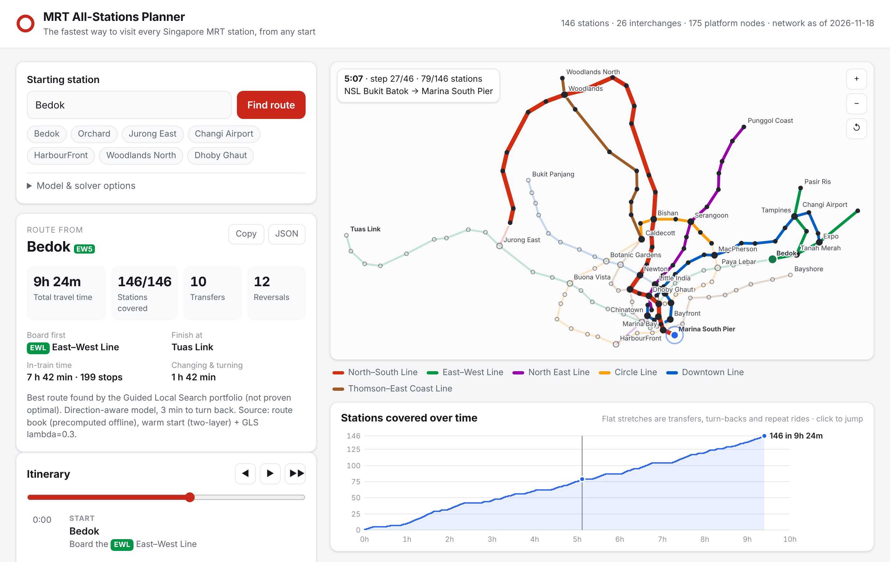

# MRT All-Stations Planner

The fastest route that visits **every Singapore MRT station**, starting from **any station you choose**,
with a web app to explore it.

This is the "all-stations challenge" as an optimisation problem: a generalised, open-loop Steiner
travelling salesman problem on the real network. The solution pipeline is:

1. a JSON dataset of the operational network,
2. a two-layer platform graph (`networkx`),
3. all-pairs shortest paths (Dijkstra),
4. a set (generalised) TSP solved with Google OR-Tools Guided Local Search,
5. a step-by-step itinerary.

An optional OR-Tools CP-SAT model can prove a route optimal.



## Quick start

```bash
python -m venv .venv && . .venv/bin/activate
pip install -r requirements.txt
```

```bash
python -m mrt_route serve            # web app on http://127.0.0.1:8000
```

```bash
python -m mrt_route Bedok            # itinerary in the terminal
```

Python 3.10+ is required. `python -m mrt_route --help` lists all commands.

## Example: starting at Bedok

```text
$ python -m mrt_route Bedok
All-stations MRT route from Bedok
================================================================
Network date        : 2026-11-18  (146 stations, 175 platform nodes)
Model               : directional graph, reversal penalty 3 min
Total travel time   : 9 h 24 min  (564 min)
Stations covered    : 146 / 146
Start line          : EWL   End station: Tuas Link
Rides / transfers   : 23 legs, 10 transfers (66 min), 12 reversals (36 min)
In-train time       : 462 min over 199 stops (54 repeat passes)

Itinerary (clock = cumulative h:mm at the end of each step)
----------------------------------------------------------------
  0:00  START     Bedok (EW5) - board EWL
  0:12  RIDE EWL  Bedok -> Pasir Ris  [4 stops, 11.5 min, +4 new, 5 covered]
                towards Pasir Ris
                via Tanah Merah, Simei, Tampines
  0:14  REVERSE   at Pasir Ris on EWL  [3 min]
  0:23  RIDE EWL  Pasir Ris -> Tanah Merah  [3 stops, 8.5 min, no new, 5 covered]
  0:28  TRANSFER  at Tanah Merah: EWL -> CGL  [5 min]  (Same-station change to Changi Airport shuttle)
  0:36  RIDE CGL  Tanah Merah -> Changi Airport  [2 stops, 8 min, +2 new, 7 covered]
  ...
  9:24  FINISH    at Tuas Link - All 146 stations visited
```

Useful options:

| Option | Effect |
|---|---|
| `--reversal-penalty 0` | Pure two-layer platform graph: turning back costs nothing. |
| `--include-upcoming` | Network as of 26 Dec 2026, adding Bedok South, Sungei Bedok and Xilin. |
| `--time-limit 10` | Seconds per Guided Local Search run. |
| `--exact 600` | Also run the CP-SAT model to improve the route and prove optimality. |
| `--live` | Ignore the precomputed route book and solve now. |
| `--json plan.json` | Write the full result, including every step, as JSON. |

## The web app

* **Station picker.** Type a name or code (`NS24`, `cc1`), or use the quick picks.
  `?start=Orchard` in the URL makes a shareable link.
* **Summary.** Total time, stations covered, transfers and reversals. At an interchange, the
  start-line comparison shows the fastest route for each first train you can take.
* **Itinerary.** Every board, ride (with the stations passed), transfer and turn-back, with the
  cumulative clock.
* **Map.** An SVG network map with zoom and pan. Replay the route step by step and watch
  stations fill in.
* **Coverage chart.** Stations covered against elapsed time. Hover for details; click to jump
  to that point in the itinerary.
* **Options.** Reversal penalty, search time, stations opening 26 Dec 2026, live re-optimisation,
  and "prove optimality" (CP-SAT, runs for minutes).
* **Export.** Copy the itinerary as text, or download the JSON.

For the default model, answers come instantly from a precomputed route book
(`mrt_route/data/route_book.json`). Any other setting triggers a live solve, which takes
about 6–20 s and shows progress.

**API**

| Endpoint | Purpose |
|---|---|
| `GET /api/network?upcoming=0\|1` | Stations, lines, segments and transfers. |
| `POST /api/solve` | Starts a solve. Body: `{"start": "Bedok", "reversal_penalty": 3, "time_limit": 6, "upcoming": false, "live": false, "exact_seconds": 0}`. Returns a job, or the result straight away if it is precomputed or cached. |
| `GET /api/jobs/<id>` | Job state, progress messages and the result. |

**Production.** `docker build -t mrt-route . && docker run -p 8000:8000 mrt-route`, or:

```bash
gunicorn -w 1 --threads 8 --timeout 0 -b 0.0.0.0:8000 "webapp.app:create_app()"
```

## How it works

### 1. Network data: `mrt_route/data/sg_mrt_network.json`

The network is a snapshot as of 18 Nov 2026.

**What's included**

* All operational MRT lines:
  * North–South Line (NSL)
  * East–West Line (EWL)
  * North East Line (NEL), including Punggol Coast
  * Circle Line (CCL), a full loop since Stage 6 (Keppel, Cantonment and Prince Edward Road
    opened 12 Jul 2026; Bayfront and Marina Bay became CC34 and CC33)
  * Downtown Line (DTL), including Hume
  * Thomson–East Coast Line (TEL), to Bayshore
* Totals: **146 stations**, 175 platforms, 26 interchanges.

**What's excluded**

* All LRT lines (Bukit Panjang, Sengkang and Punggol).
* Built but unopened stations: Mount Pleasant, Marina South, Bukit Brown.
* Future lines: Jurong Region Line and Cross Island Line.
* Walks between nearby but separate stations, such as Esplanade and City Hall. **Transfers only
  exist inside official interchanges.**

**Changi Airport branch.** It runs as a shuttle from Tanah Merah, so it is its own platform layer
(`CGL`) with a 5-minute change at Tanah Merah.

**Run times.** `next_min` on each stop is the in-train time to the next stop. Times are estimated
from station spacing:

* 1.1 min for dwell and acceleration, plus 0.8 min per km of track, rounded to 0.5 min.
* Most stops take 2–3 min. Long gaps run up to 4.5 min, such as Khatib–Yio Chu Kang.
* Line totals match real end-to-end times. For example, Jurong East–Marina South Pier is
  65.5 min and HarbourFront–Punggol is 32.5 min.

**Interchange penalties** cover walking plus average waiting:

* 5 min for cross-platform interchanges: Jurong East, City Hall, Raffles Place, Tanah Merah and
  Bayfront.
* 6–8 min for most other interchanges.
* Up to 10 min for long multi-level ones: Dhoby Ghaut NSL↔CCL and Outram Park EWL↔TEL.

**Opening dates.** A stop with `"opens": "YYYY-MM-DD"` is skipped before that date, and the run
times on either side are merged. The dataset already contains TEL Stage 5 and the DTL Stage 3
extension, opening 26 Dec 2026. After that date they are used automatically, or straight away
with `--include-upcoming`.

**Validation.** The loader checks the data and refuses to run if:

* a station has no coordinates,
* a run time is not positive,
* a station appears twice in one route,
* an interchange is missing a transfer time for any pair of its lines,
* the network is disconnected.

To extend the network, add stops to a line's `routes` and add an entry in `interchanges` for
each new pair of lines.

### 2. Two-layer platform graph (`mrt_route/graph.py`)

There is one node per (station, line) platform: `CityHall_NSL`, `CityHall_EWL`, and so on.

* **Ride edges** join adjacent stations on the same line.
* **Transfer edges** join the platforms of one interchange.

Changing lines therefore costs exactly the interchange penalty.

**Direction-aware refinement** (default: 3 min). In the pure two-layer graph, riding A→B→A is
free at B. In reality you must alight and wait for a train the other way, including at every
line terminus. When the reversal penalty is above zero, each platform is expanded into:

* `board(P)`: on the platform, free to go either way;
* `arr(P, Q)`: on a train that arrived at P from Q.

Staying on the train is free, turning back costs the penalty, and changing lines costs the
interchange penalty. This gives 513 states in place of 175 nodes. Set the penalty to 0 to get the
exact two-layer model.

### 3. Offline all-pairs shortest paths (`mrt_route/paths.py`)

Dijkstra runs from every node and stores dense cost and predecessor matrices; any path is rebuilt
on demand. Edge costs are integer milliseconds, plus a 1 ms tie-breaker per change, so equally
fast alternatives prefer fewer transfers.

| Model | Graph size | Precomputation time |
|---|---|---|
| Two-layer | 175 nodes, 402 edges | 0.04 s |
| Direction-aware | 513 nodes, 1,127 edges | 0.4 s |

### 4. Generalised TSP with OR-Tools (`mrt_route/solver.py`)

**Clusters.** Every station except the start is a cluster of its platforms (or arrival states).
`AddDisjunction(cluster)` with no penalty makes exactly one node per cluster mandatory, so visiting
*any* platform of an interchange covers the station.

**Metric closure.** Arc costs are the shortest-path times, so stations passed on the way are
covered for free. This makes the GTSP optimum equal to the true optimum walk (the Steiner TSP).

**Open loop.** Node 0 is a virtual source at the start station. Node 1 is a dummy end that every
node reaches at cost 0, so the route ends at whichever station minimises the total.

**Exact reduction.** Some stations are articulation points of the network: every route to a line
end must pass through them, for example Jurong East … Tuas West Road on the way to Tuas Link.
These are dropped as targets, which removes about 34 of 145 clusters. This mattered a lot: with
the reduction, Guided Local Search found the proven optimum for Bedok; without it, it stalled 3%
above.

**Guided Local Search portfolio.** PATH_CHEAPEST_ARC builds a first solution, then Guided Local
Search improves it. The best GLS penalty factor λ varies by station, so a small portfolio runs in
parallel processes:

* λ = 0.3, 1.0 and 2.5;
* in direction-aware mode, also a run warm-started from the two-layer solution.

Each run ends with an exact dynamic program that picks the best node within every cluster for the
station order found.

**Start lines.** Every line at the start station is solved as the first train you take, and the
fastest is returned. All results are shown in the start-line comparison.

### 5. Optimality certificate (`mrt_route/exact.py`, optional)

CP-SAT solves the same problem exactly, as a generalised directed rural-postman model:

* integer arc-use counts,
* Euler-path flow balance from the start to a free end,
* station coverage,
* connectivity cuts added lazily in a cutting-plane loop.

When the loop ends with a connected solution, that solution is optimal. Otherwise the solver's
bound gives the optimality gap.

* **Bedok, two-layer model:** proven optimal at **528 min (8 h 48 min)**. The GLS portfolio finds
  the same route in 6 s.
* **Bedok, direction-aware model:** RESULT_DIRECTIONAL

Exact runs take minutes, so they are opt-in (`--exact SECONDS`, or the web app option).

### 6. Route book (`python -m mrt_route precompute`)

The precompute runs the portfolio for every station and every start line, with 10 s per run, and
stores each station order. At load time each route is rebuilt from the shortest paths and checked
against its stored time, so a stale book is ignored automatically.

## Results (default model, 18 Nov 2026 network)

RESULTS_TABLE

## Assumptions and limitations

* **Times are estimates.** There is no timetable: headways are averaged into the transfer and
  reversal penalties, and run times come from station spacing. Change any number in the JSON and
  re-solve.
* **Service patterns are simplified.** The Circle Line loop, the Dhoby Ghaut spur and the Changi
  shuttle are modelled as track. Peak-hour and off-peak through-running at Promenade and Stadium
  is treated as always available.
* **Heuristic answers by default.** Results from the GLS portfolio are the best routes found, not
  guaranteed optimal. Use `--exact` for a certificate or a gap.

## Project layout

```text
mrt_route/
  data/sg_mrt_network.json   network dataset (source of truth)
  data/route_book.json       precomputed best routes (default model)
  network.py                 loading, opening dates, validation, station lookup
  graph.py                   two-layer platform graph + direction-aware search graph
  paths.py                   all-pairs shortest paths (Dijkstra) + path reconstruction
  solver.py                  OR-Tools GTSP, GLS portfolio, DP cluster re-optimisation
  exact.py                   CP-SAT exact model / optimality certificate
  itinerary.py               step-by-step itinerary and text formatting
  planner.py                 plan_route() API, route book
  precompute.py, cli.py      offline precomputation, command line
webapp/                      Flask app (app.py), templates/index.html, static/app.js + style.css
tests/                       pytest suite (data, graphs, solver, exact, itinerary, CLI, API)
```

```bash
pip install pytest && python -m pytest
```

## Data notes

Station coordinates (4 decimal places) are used only to draw the map and estimate run times. They
were cross-checked against public LTA DataMall-derived station data. Locations of the stations
opening on 26 Dec 2026 are approximate. Line status is as reported by LTA:

* Circle Line Stage 6 opened 12 Jul 2026.
* TEL Stage 5 and DTL3e open 26 Dec 2026.
* Jurong Region Line Stage 1 is expected mid-2028.
